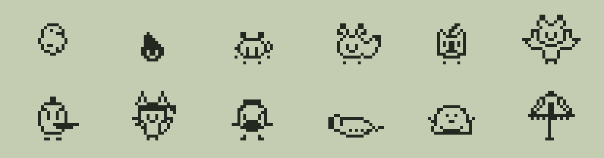

<p align="center"></p>

<h1 align="center">Hitodama</h1>

<p align="center">A pocket yokai that lives in a pane beside the Claude Code chat and grows from how you look after it.</p>

<p align="center">
  <a href="LICENSE"></a>
  
  <a href="https://github.com/nyxene/hitodama/actions/workflows/gates.yml"></a>
</p>

Every life starts as an egg on a small monochrome LCD. Five minutes later a soul flame hatches, and over about a week it grows through a child and a teen into one of six adult yokai from Japanese folklore, and one of them can turn into a secret seventh. Which one depends on how you look after it: feed it, clean up, put it to bed, answer its calls, stop its tantrums.

It also lives off your session. Long context weighs down its backpack, a high effort setting makes it think hard alongside the model, helpers you start wait with it by the door, night work makes it grumpy, and hitting your five-hour usage limit puts it to rest until the reset: no calls and no tantrums, and one already open waits. `/compact` is a relief. None of this changes what it grows into.

## Install

In a Claude Code terminal session:

```
/plugin install hitodama --marketplace nyxene/hitodama
```

From a shell:

```sh
claude plugin install hitodama --marketplace nyxene/hitodama
```

The pane opens on the next session start. `/hd` opens it any time, `/hd stats` prints the pet's statistics, collection and memorial.

## Requirements

- Claude Code 2.1.310 or newer (the version CI tests), in a terminal. The LCD is drawn only in the terminal; other surfaces show the text and the buttons.
- A pane at least 32 columns wide inside its frame. From 64 columns and 38 rows inside the frame the screen doubles in size.

## Care

Keys work while the pane has focus.

| Key | Action |
| --- | --- |
| 1 | Meal: fullness and weight |
| 2 | Snack: mood. Five in an hour make it sick |
| 3 | Play: guess which way it turns, five rounds |
| 4 | Clean up |
| 5 | Heal: a badly sick pet needs a second dose |
| 6 | Light on or off at bedtime |
| 7 | Discipline: stops a tantrum. Scolding for no reason hurts its mood |
| 8 | Stats |

During play, 1 and 2 guess left or right and 9 quits the game.

A call left unanswered for 15 minutes is a care mistake; a tantrum left alone is a discipline mistake. It falls asleep at its bedtime; asleep it calls only for the light or medicine, and hunger does not count towards starving. Mistakes decide what it grows into, and the rules are in [docs/yokai.md](docs/yokai.md), with the folklore behind each character. Starve it for 12 hours, or let an illness run, and it dies; a grown yokai also dies of old age at the end of its life span. A new egg arrives a minute later.

While Claude Code is closed the pet is "in your pocket": its needs drop at 30% of the speed, it makes no calls (one already open gets its full 15 minutes again when you return), and nothing can kill it, so a weekend away is safe. It still ages, and a pet whose life span ran out while you were away dies once you are back. It will be hungry when you come back, and hunger counts towards starving again from then, on top of any hours it had starved before. With several sessions open, the pet stays in the one you typed in last, and the others show where it went.

## Settings

Run `/config` and find Hitodama.

| Option | Values | Default |
| --- | --- | --- |
| `language` | `en` English, `ru` Русский, `zh` 中文, `ja` 日本語, `ko` 한국어, `es` Español, `pt` Português, `de` Deutsch, `fr` Français | `en` |

## Privacy

Hitodama makes no network requests and sends nothing anywhere. What it touches:

- **Files:** reads and writes only `~/.claude/hitodama/`: `pet.json` (the pet, its journal, its statistics with the models, effort levels and token counts, and the session ids whose events it has applied), `history.json` (past lives and seen characters) and `seen/<session>.json` (one small file per session, so sessions can tell who has the pet; mods cannot delete files, so old ones stay until you remove them).
- **Session data:** the session id (to name its file), the name of the repository or working folder (shown in the pane and in your other sessions), the model name, effort level, context fill percentage, five-hour usage percentage and reset time, the number of reply tokens, helper and failed tool counts, aborted turns, compactions, and when you last typed. It never reads your prompts, replies, files or transcript.
- **Environment:** reads `HOME` (or `USERPROFILE`) to find your home folder. Without either, or when it is not an absolute path, it writes one line saying so to the transcript and does nothing else.
- **Processes:** runs `date +%z` once per session (`/bin/date`, then `/usr/bin/date`, then the one on `PATH`, each tried only when the one before gave no offset) to learn your local UTC offset for bedtimes; without it, it takes the offset the runtime reports.
- **Sessions:** only sessions with a person at the prompt take part; `claude -p` runs and the SDK leave the pet alone.
- **Notifications:** when the pet calls, throws a tantrum or dies and you have not typed for a minute.

`claude plugin validate` lists every call the mod makes, if you want to check.

## Limitations

- Mods run with your permissions. Organizations that allow only managed mods will refuse Hitodama.
- A damaged `pet.json` stops the pet, with one line in the transcript after three skipped ticks, instead of replacing it with an egg; fix the file or delete it to start over.
- Switching the active session hands the pet over within one three-second tick; in rare cases the old session writes one more tick.
- The interface translations other than English and Russian were written without a native speaker's review. Corrections are welcome as issues.

## Contributing

See [CONTRIBUTING.md](CONTRIBUTING.md). Security problems go through [SECURITY.md](SECURITY.md), not issues.

## License

[MIT](LICENSE). The yokai are figures of Japanese folklore in the public domain; the pixel art is original.

Hitodama is an unofficial project and is not affiliated with or endorsed by Anthropic.
