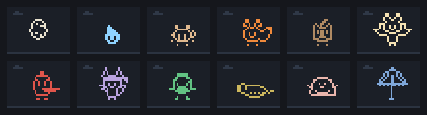
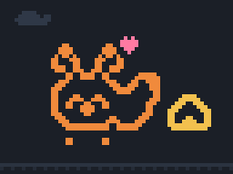

<p align="center"></p>

<h1 align="center">Hitodama</h1>

<p align="center">A pocket yokai that lives in a pane beside the Claude Code chat and grows from how you look after it.</p>

<p align="center">
  <a href="LICENSE"></a>
  
  <a href="https://github.com/nyxene/hitodama/actions/workflows/gates.yml"></a>
</p>

<p align="center"></p>

Every life starts as an egg on a small pixel screen. Five minutes later a soul flame hatches, and over about a week it grows through a child and a teen into one of six adult yokai from Japanese folklore, and one of them can turn into a secret seventh. Which one depends on how you look after it: feed it, clean up, put it to bed, answer its calls, stop its tantrums.

## It lives off your session

- **Context** weighs down its backpack; `/compact` is a relief.
- **Effort**: a high setting makes it think hard alongside the model.
- **Helpers** you start wait with it by the door.
- **Night work** makes it grumpy.
- **Energy** goes on your replies: by their length and the model, up to a cap, more with a long context, at night, or when you use your limit faster than its window passes. It comes back in sleep, and slowly once no window has been busy for 15 minutes.
- **The usage limit** (the five-hour one, or the weekly one on a plan without it) puts it to sleep until the reset: no calls, no tantrums, nothing can kill it, and you can still feed it.
- **Focus**: while Claude works in its session and the pet is awake, its fullness and mood fall at half the speed, no tantrum starts, and its calls wait for the turn to end unless it is starving or sick.
- **Permission prompts**: when Claude asks for permission in one session, the pane in every other one names it.

What it grows into depends only on its care mistakes and its discipline; a bad mood from your session can still make it call for you.

## Install

In a Claude Code terminal session:

```
/plugin install hitodama --marketplace nyxene/hitodama
```

From a shell:

```sh
claude plugin install hitodama --marketplace nyxene/hitodama
```

The pane opens on the next session start. `/hd` opens it any time, `/hd stats` prints the pet's statistics, collection and memorial.

After an update, restart every open window (`/exit`, then the `claude --resume` command it prints): a window keeps the version it started with. From 0.5.3 on, one still on an older version than another open window leaves the pet to the newer ones, and its pane says so; windows of 0.5.2 and before cannot tell.

## Requirements

- Claude Code 2.1.310 or newer (the version CI tests), in a terminal. The screen is drawn only in the terminal; other surfaces show the text and the buttons.
- A pane at least 32 columns wide inside its frame.

## Care

Keys work while the pane has focus.

| Key | Action |
| --- | --- |
| 1 | Meal: fullness and weight |
| 2 | Snack: mood. Five in an hour make it sick |
| 3 | Play: guess which way it turns, five rounds |
| 4 | Clean up |
| 5 | Heal: a badly sick pet needs a second dose |
| 6 | Light on or off at bedtime |
| 7 | Discipline: stops a tantrum. Scolding for no reason hurts its mood |
| 8 | Stats |

During play, 1 and 2 guess left or right and 9 quits the game.

- A call left unanswered for 15 minutes is a care mistake; a tantrum left alone is a discipline mistake. Mistakes decide what it grows into: the rules and the folklore behind each character are in [docs/yokai.md](docs/yokai.md).
- It falls asleep at its bedtime. Asleep it calls only for the light or medicine, and hunger does not count towards starving.
- Starve it for 12 hours, or let an illness run, and it dies; a grown yokai also dies of old age at the end of its life span. A new egg arrives a minute later.
- While Claude Code is closed the pet is "in your pocket": its needs drop at 30% of the speed, it makes no calls, and nothing can kill it, so a weekend away is safe. It still ages, and it will be hungry when you come back.
- With several sessions open, the pet stays in the one you typed in last, and the others show where it went.

## The pane

The pane lays itself out by its size:

- **Tall:** the screen on top, from 32 up to 64 columns wide, keeping its shape, with everything under it as wide as the screen.
- **Wide and short:** the screen on the left, the text and the buttons beside it.
- **Too small for the screen:** the text and the buttons alone; when even they do not fit, the needs go on one line.

The journal under it keeps what happened, each entry wrapping under its own text; keys that change nothing (feeding a sleeping pet, say) answer on the screen and stay out of it.

## Settings

Run `/config` and find Hitodama. Each setting is described in [docs/settings.md](docs/settings.md), with a picture of it off and on where the screen shows it.

| Setting | Default | |
| --- | --- | --- |
| `language` | `auto` | Claude Code's own language, or one set by hand |
| `colourScreen` | on | each yokai in its own colour; off, the two-grey LCD |
| `colourBars` | off | the bars coloured by level |
| `detail` | `pixel` | or `braille`: finer, in braille dots |
| `smallPixels` | on | smaller pixels on a screen wider than 32 columns |
| `itemColours` | on | food, droppings, hearts and medicine each in their colour |
| `scenery` | on | the ground, clouds by day, stars by night |
| `particles` | on | hearts rising while it eats or walks |

## Privacy

Hitodama makes no network requests and sends nothing anywhere. What it touches:

- **Files:** reads and writes only `~/.claude/hitodama/`: `pet.json` (the pet, its journal, its statistics with the models, effort levels and token counts, and the session ids whose events it has applied), `history.json` (past lives and seen characters), `pet.prev.json` and `history.prev.json` (spare copies of the two, each written just before it) and `seen/<session>.json` (one small file per session, so sessions can tell who has the pet; mods cannot delete files, so old ones stay until you remove them).
- **Session data:** the session id (to name its file), the name of the repository or working folder (shown in the pane and in your other sessions), the model name, effort level, context fill percentage, the five-hour usage percentage (or the weekly one when there is no five-hour limit) with its reset time and when it was read, the number of reply tokens, helper and failed tool counts, aborted turns, compactions, when you last typed, and when Claude Code showed a permission prompt (it is told the notice's text, such as the tool's name, and keeps only that one showed). With the `auto` language it also reads Claude Code's `/config` rows and keeps only the language setting. It never reads your prompts, replies, files or transcript.
- **Environment:** reads `HOME` (or `USERPROFILE`) to find your home folder. Without either, or when it is not an absolute path, it writes one line to the transcript saying what to set, and does nothing else.
- **Processes:** runs `date +%z` once per session (`/bin/date`, then `/usr/bin/date`, then the one on `PATH`, each tried only when the one before gave no offset) to learn your local UTC offset for bedtimes; without it, it takes the offset the runtime reports. On macOS it runs `/usr/bin/pmset -g batt` every five minutes to learn whether the machine runs on battery; elsewhere that fails and it counts as plugged in.
- **Sessions:** only sessions with a person at the prompt take part; `claude -p` runs and the SDK leave the pet alone.
- **Notifications:** when the pet calls, throws a tantrum or dies and you have not typed for a minute.

`claude plugin validate` lists every call the mod makes, if you want to check.

## Power

Every open window ticks every three seconds: it reads the other windows' files and the pet. What else runs is kept to what someone can see:

- The pet moves, two frames a second, only while its pane is shown and the window was used in the last ten minutes (you typed, or Claude or a helper worked in it). Otherwise it holds its last frame, which is redrawn only when the scene changes.
- A window writes its own file when something in it changes, else every 15 seconds. The window that looks after the pet writes `pet.json` when anything it shows changes, else every 30 seconds, and always when it closes.
- On battery (macOS) the pet moves at one frame a second and both intervals double.

## Limitations

- Mods run with your permissions. Organizations that allow only managed mods will refuse Hitodama.
- A damaged `pet.json` or `history.json`, such as a write cut short when a window closes, gives way to its spare copy (`pet.prev.json`, `history.prev.json`), written just before it; the next write puts the file right. It does so without a word: with many windows open it is mostly a read while another window writes, and nothing a window wrote is lost (a broken hand edit is lost, replaced by the spare copy). Only when both copies of the pet are damaged does it stop instead of replacing it with an egg, and writes one line to the transcript in the pet's language saying what to do: fix the file, or delete `pet.json` to start over. Any other failure goes on retrying every tick and is noted in the debug log only.
- Switching the active session hands the pet over within one three-second tick; in rare cases the old session writes one more tick.
- A session where Claude asked for permission shows in the others' panes until the tool call ends, so also while a call you allowed runs; any other tool call ending there, in parallel or in a helper, takes it off early. Claude Code gives mods no event for the moment you allow a call.
- The interface translations other than English and Russian were written without a native speaker's review. Corrections are welcome as issues.

## Contributing

See [CONTRIBUTING.md](CONTRIBUTING.md). Security problems go through [SECURITY.md](SECURITY.md), not issues.

## License

[MIT](LICENSE). The yokai are figures of Japanese folklore in the public domain; the pixel art is original.

Hitodama is an unofficial project and is not affiliated with or endorsed by Anthropic.
