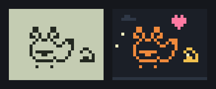
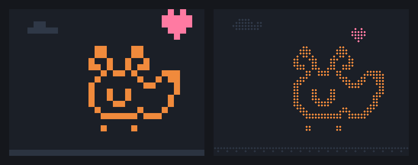
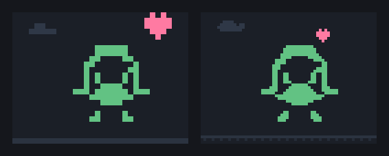
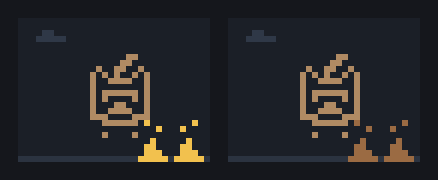
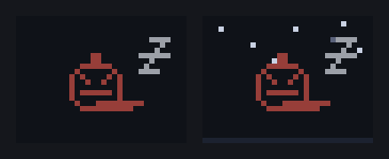
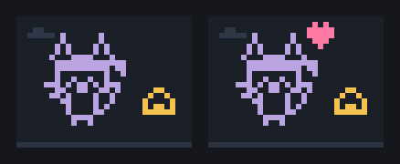

# Settings

Run `/config` in Claude Code and find Hitodama. Every setting applies to the session at once; in the pictures, off is on the left and on on the right.

## language

`auto` (the default) speaks Claude Code's own language. Hitodama knows it by its code, its English name or its own name ("ru", "Russian", "Русский", "日本語"), and follows it when you change it in `/config`. A language it does not have is English.

Set by hand, it stays whatever Claude Code's is: `en` English, `ru` Русский, `zh` 中文, `ja` 日本語, `ko` 한국어, `es` Español, `pt` Português, `de` Deutsch, `fr` Français.

## colourScreen

On by default: a dark screen with each yokai in its own colour. Off, the screen is two greys, as on a pocket LCD.

## colourBars

Off by default. On, the filled part of each bar under the screen takes the colour of its level from your Claude Code theme: green when it is fine, yellow when it gets low, red when it needs you. An empty bar colours its number. Load (how full the context is) is the other way round: red when it is heavy.

## detail

`pixel` (the default) draws the picture in pixels, two to a terminal cell. `braille` smooths it and draws it in braille dots, four times as many in the same space, one colour to a cell; how the dots look depends on your terminal's font.

## smallPixels

On by default. On a screen wider than 32 columns, the picture is smoothed to 64 × 48 pixels, each smaller, its curves rounder. Off, the 32 × 24 pixels are made bigger. Braille is always smoothed.

## itemColours

On by default, on the coloured screen. Things around the pet take their own colours: food yellow, droppings brown, sleep white, hearts pink, medicine blue, alarms red. Off, they are all yellow.

## scenery

On by default, on the coloured screen: the ground under the pet, clouds drifting by day and stars at night.

## particles

On by default, on the coloured screen: hearts rising while the pet eats or walks, and a few sparks.

